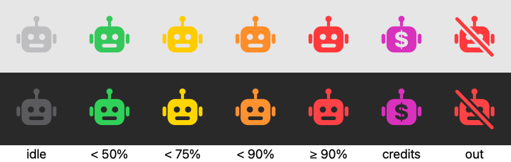

<p align="center">
  
</p>

<h1 align="center">Claude Usage Bar</h1>

<p align="center">
  Your Claude plan usage in the macOS menu bar — for <strong>every</strong> Claude Code account on the machine,
  without ever touching your login.
</p>

## What you get

- 🤖 **A robot in the menu bar** whose color is your status — green, yellow, orange, red as the
  session fills; grey when the account is idle.
- 📊 **Everything the Claude UI shows**, in a native menu: current session, weekly (all models and
  per model), resets, usage credits, and the plan — "Max (20x)", "Team (5x)".
- 👥 **All your accounts.** Personal and work, `~/.claude` and `~/.claude-anything`. Switch in the
  menu; the icon follows.
- 🔒 **Nothing to configure, nothing to store.** No API key, no settings file, no account list.

<p align="center">
  
</p>

## How this one is different

Most usage trackers do two things that quietly go wrong. This one does neither.

### It sees every account, not just the default one

Claude Code keeps each account's OAuth token in the login Keychain under a service name that depends
on whether `CLAUDE_CONFIG_DIR` was set when you logged in — unset gives `Claude Code-credentials`,
set gives `Claude Code-credentials-<first 8 hex of sha256(path)>`. A GUI app launched from Finder has
no `CLAUDE_CONFIG_DIR` in its environment, so a tracker that reads "the" credentials sees the default
account and nothing else.

Claude Usage Bar scans `$HOME` for `.claude*` directories that hold a login, derives the Keychain
name for each one by the same rule Claude Code uses, and reads them all. When one directory has two
entries (a login with the variable unset, later sessions with it set), it takes the one Claude Code
is actually using — the freshest.

### It never refreshes your token — so it never signs you out

When an access token expires, the obvious move is to use the refresh token to mint a new one. Don't:
the token endpoint **rotates the refresh token and revokes the old one on every call**. Any tool that
refreshes out-of-process leaves Claude Code holding a dead refresh token, and the next time Claude
Code needs one, you're logged out. We verified this live, on our own account, before deciding.

So this app is strictly read-only over Claude Code's state. An expired token means the account has
been idle since it expired — not logged out; Claude Code refreshes silently the next time you use it.
The menu keeps the last numbers, dims them, and says so.

### It behaves like a menu bar extra is supposed to

A real `NSMenu`, attached under the icon with the system's chrome, as the Human Interface Guidelines
ask — not a floating panel. Standard items for the commands, one custom item for the status block,
the way Battery and Wi-Fi do it. Polls every fifteen minutes, backs off when Anthropic says so, and
keeps the last snapshot through throttling so the menu never goes blank.

## Install

Requires macOS 14 or later and at least one Claude Code login on the machine.

```bash
git clone https://github.com/mike-bronner/claude-usage-bar.git
cd claude-usage-bar
make install      # builds, signs, copies to /Applications, launches
```

`make install` signs with your own Apple Development identity (`security find-identity -v -p
codesigning`; override with `SIGN_IDENTITY=<sha1>`). Turn on **Launch at Login** from the menu.

### About the Keychain prompt

On first launch macOS shows, once per account:

> **ClaudeUsageBar wants to use your confidential information stored in "Claude Code-credentials"
> in your keychain.** To allow this, enter the login keychain password.

This is the standard dialog for any app that reads a Keychain item another app created — here,
the login token Claude Code stored when you signed in. The password is required only because
**Always Allow** edits that item's access list; choose it and you won't be asked again. Nothing else
in the app touches the Keychain, and the token exists nowhere else on macOS (Claude Code's only
alternative is a plaintext file, which would be far worse).

The app explains this in a dialog before the first prompt. The entire Keychain code is
[`KeychainCredentials.swift`](Sources/ClaudeUsageBarCore/KeychainCredentials.swift) — one read,
no writes. It also reads as few items as it can: for the default account it stops at the first
valid entry, so most people see exactly one prompt per account.

## Development

```bash
swift build
swift test      # no network, no Keychain — everything is stubbed
make run        # run unbundled, signed, from .build/debug
make probe      # print discovered accounts and the raw usage response; never prints a token
make bundle     # assemble and sign .build/ClaudeUsageBar.app
```

SwiftPM package, no Xcode project; open `Package.swift` in Xcode if you want an IDE. Swift 6 strict
concurrency throughout. [CLAUDE.md](CLAUDE.md) has the architecture, the Keychain derivation rule,
and the reasoning behind the read-only decision.

## Privacy

The app reads two things: `.claude.json` in each Claude config directory (for the account's email
and organization) and that account's OAuth token from your Keychain. The token goes to one place —
`https://api.anthropic.com/api/oauth/usage`, the same endpoint Claude Code itself calls — and is
never written anywhere, logged, or shown. There is no telemetry.
